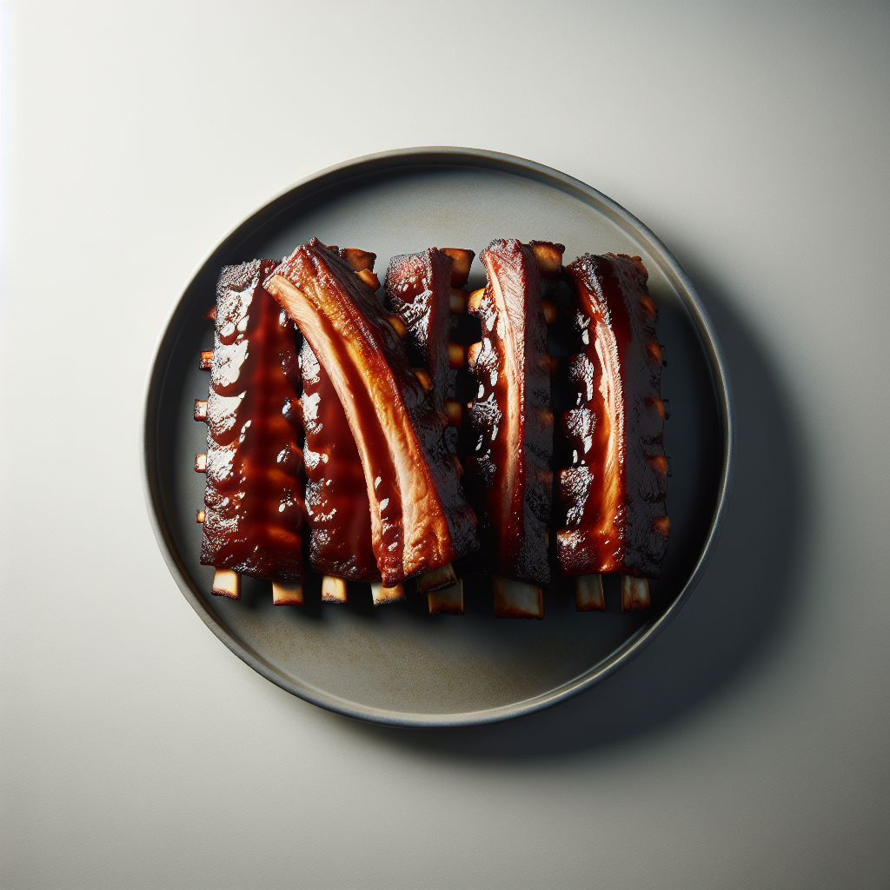

---
tags:
    - usa
    - middag
---
# BBQ spareribs

## Ingredienser

Rub

- 4 msk brunt socker
- 4 msk vitt socker
- 4 msk gullökssalt
- 2 msk chilli puder
- 1 msk salt
- 1 msk rökt paprika krydda
- 1 msk peppar
- 1 msk cayenne peppar

Glaze

- 4 msk ketchup
- 4 msk French mustard
- 5 msk vitvins vinäger eller äpplecider vinäger
- 12 msk brunt socker

## Gör så här

1. Gnugga in rubben på alla ytor och sätt in i kylen. Helst över natten.
2. Sätt revbenen på grillen eller rökaren först under 3 timmar. Jag använder en rökningsmetod som kallas 3,2,1 metoden.
3. Ta aluminiumfolie runt revbenen och lägg på grillen i två timmar och sätt lite äpplecidervinäger eller äpplejuice (detta steget kan vara längre eftersom fukten bevaras av aluminiumfoliet).
4. Under tiden revbenen är i grillen eller rökaren kan du göra glazen. Blanda bara ihop alla ingredienser i en kastrull och sedan värm upp glazen i alla fall i 15 minuter (kan gärna värma längre). Målet med detta är att allt brunt socker ska gå från fast till flytande form.
5. Efter i alla fall två timmar i grillen eller rökaren tar du bort aluminiumfoliet och när det är ungefär 10 minuter kvar kan du sätt på glazen (om man vill kan man skippa denna timmen och sätta på glazen direkt efter de två timmarna i aluminiumfolie).
6. Låt revbenen villa i minst 10 minuter och servera. Om någon glaze blir över kan man sätta det i en skål och så kan man ta extra om man vill.
