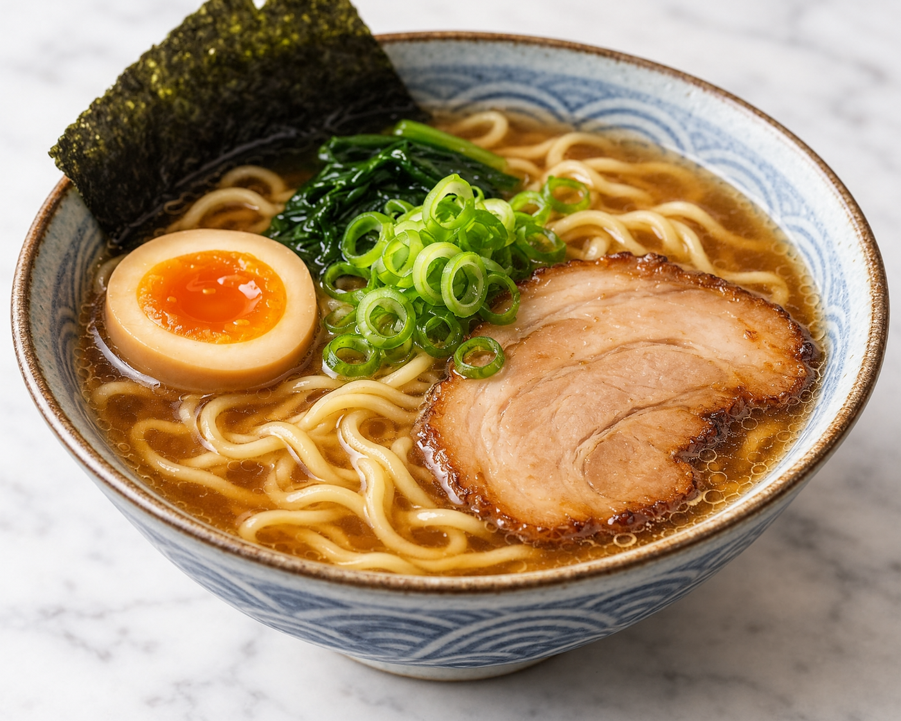

---
tags:
    - japan
    - middag
---
# Ramen

## Ingredienser

### Buljong

- 1 bit kombualg (ca 15 cm)
- 8 shiitakesvampar
- 0,5 dl bonitoflingor
- 1 kg fläskkarré
- 1 kyckling (1,2 kilo)
- 1 purjolök
- 5 cm ingefära
- 2 vitlöksklyftor
- 1 tsk salt
- 1,5 l vatten
- 2 msk japansk soja
- 2 msk risvinäger
- 1 msk sesamolja

### Protein

- 6 salladslökar
- 0,5 vitlöksklyfta
- 60 g ingefära
- 3,5 dl vatten
- 2,5 dl japansk soja
- 3 msk kinesisk soja
- 2,5 dl mirin (söt matlagningssake)
- 1 dl råsocker
- 3 msk risvinäger

### Topping

- Äggnudlar
- 6 salladslökar
- 2 pak choi
- 6 ägg
- Sesamfrön

## Gör så här

### Buljong

1. Skär karrén på längden så att den blir platt och kan rullas ihop till en rulle. Bind med steksnöre runt om.
2. Koka buljongen. Skär bort bröst- och lårfiléer från kycklingen och använd till en annan rätt.
3. Sjud på låg värme under lock i 4–5 timmar. Karrén ska ligga i buljongen i minst 2 timmar.
4. Sila buljongen först i ett durkslag och sedan i en finmaskig sil. Är det mycket fett på ytan kan en del tas bort med en sked. Ta inte bort allt; i fettet finns mycket smak. Plocka köttet från kycklingens bröst och vingar.

### Protein

1. Ansa salladslöken. Skala vitlöken och ingefäran. Koka ihop vatten, de båda sojasorterna, mirin, socker, vinäger, salladslök, vitlök och ingefära i en kastrull till en marinad.
2. Lägg karrén i marinaden. Låt svalna och marinera i kylen över natten, ca 12 timmar.
3. Värm köttet i buljongen eller i ugn.

### Topping

1. Blanda en smaksättning av soja, risvinäger och sesamolja.
2. Rosta sesamfrön i en torr stekpanna tills de får fin färg.
3. Koka äggen i ca 6,5 minuter för ett mjukt, krämigt inre. Låt dem sedan svalna i kallt vatten innan de skalas.
4. Ansa och strimla salladslöken.
5. Förväll pak choi i kokande vatten i ca 2 minuter.
6. Tillaga nudlarna enligt grundreceptet.
7. Smaka av buljongen med smaksättningen. Lägg nykokta nudlar och kött i skålar. Toppa med grönsaker som läggs i grupper. Häll på het buljong. Strö över sesamfrön.
