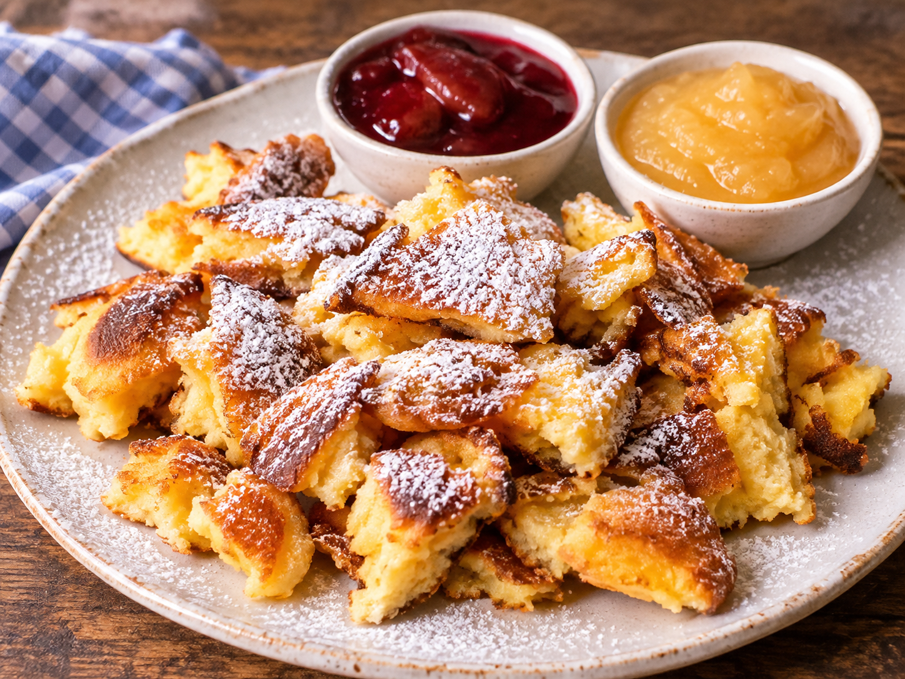

---
tags:
    - österrike
    - efterrätt
---
# Kaiserschmarrn

## Ingredienser

### Kaiserschmarrn

- 6 äggulor
- 1 nypa salt
- ca 250 ml mjölk eller grädde
- 150 g vetemjöl
- 6 uppvispade äggvitor
- 50 g strösocker
- 50 g smör
- Russin
- Florsocker

### Äpplekompott

- 2–4 äpplen (inte för söta, inte för sura – "Pink Lady" är ett utmärkt val)
- 1 kanelstång
- 4 kryddnejlikor
- Lite socker (så mycket du vill, men kom ihåg: inte för sött)
- En bit citronskal

### Plommonkompott

- 500 g plommon
- 100 g strösocker
- 4 msk rom
- 1 kanelstång
- 2 kryddnejlikor

## Gör så här

### Kaiserschmarrn

1. Blanda äggulor, vetemjöl, salt och mjölk till en lös smet.
2. Vispa äggvitorna, tillsätt sockret sked för sked och vänd sedan mycket försiktigt ihop äggvitorna med smeten. Ju fluffigare den färdiga smeten blir, desto bättre.
3. Smält smöret i en (inte för het) stekpanna och tillsätt lite socker i det smälta smöret innan du häller i smeten – det karamelliserar Kaiserschmarrn en aning. Häll i smeten och lägg på ett lock i 1–2 minuter. Tillsätt russinen, vänd och låt smeten stå igen för att grädda färdigt. Grädda långsamt; hur lång tid det tar beror verkligen på din spis och panna. Den färdiga Kaiserschmarrn ska vara ljusbrun på utsidan och gul på insidan.
4. Riv i små bitar, strö över socker och servera genast.

### Äpplekompott

1. Skala äpplena, skär dem i stora bitar och ta bort kärnhuset.
2. Lägg alla ingredienser i en stor kastrull.
3. Tillsätt vatten – äpplena ska vara täckta av vattnet.
4. Låt sjuda i ca 10 minuter och låt sedan svalna.
5. Släng inte vattnet – det smakar verkligen gott! Servera det tillsammans med äpplena i en liten skål.

### Plommonkompott

1. Halvera eller dela plommonen i fyra och kärna ur dem.
2. Lägg plommonen i en kastrull tillsammans med socker, rom, kanelstång och kryddnejlikor och låt sjuda på svag värme tills de är mjuka, ca 10 minuter.
3. Häll över kompotten i en skål för att den snabbt ska svalna, ställ den eventuellt i ett kallt vattenbad.
4. Ta bort kanelstången och kryddnejlikorna.
